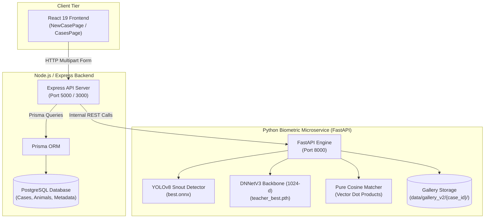
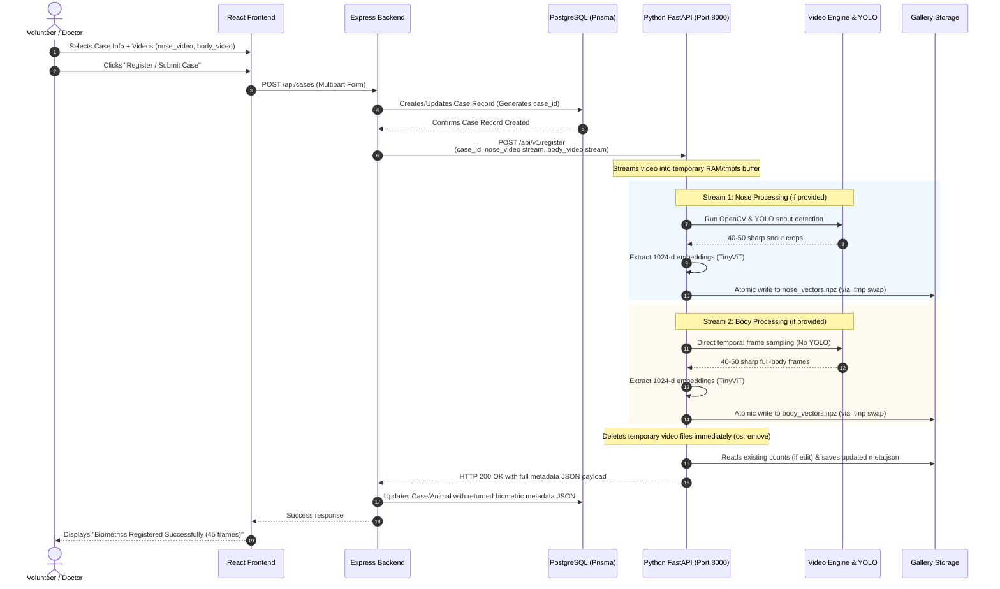
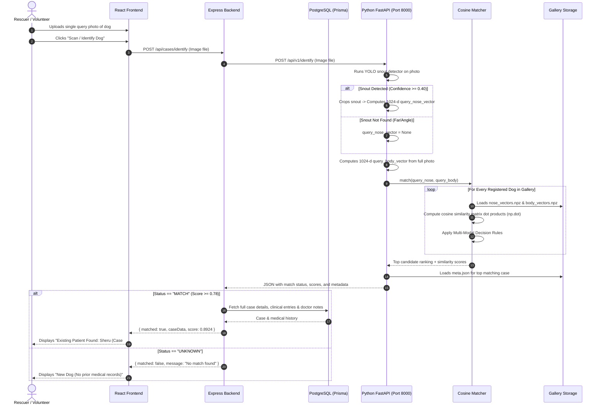

# Complete System Workflow: PFA Web Portal × Vidog Biometrics

This document maps out the entire architectural and procedural lifecycle of the system. It covers what the website calls, how our service responds, which files are created, and the precise control flow for both **Registration** and **Identification**.

---

## 1. High-Level Architecture & Component Roles



| Component | Responsibility |
| :--- | :--- |
| **React Frontend** | Form capture (case details, videos, query photo). Displays biometric feedback. |
| **Express Backend** | Business logic, authentication, saving initial case record in PostgreSQL, and forwarding media streams to Python. |
| **Python FastAPI (`api.py`)** | Video frame extraction, snout detection, dual-stream feature embedding (1024-d), vector file creation, and cosine similarity ranking. |
| **PostgreSQL** | Stores shelter records, case IDs, and the returned biometric `metadata` JSON object. |
| **Disk Gallery (`gallery_v2/`)** | Stores only `.npz` vector matrices and `meta.json`. **No raw videos or images are permanently stored on disk.** |

---

## 2. WORKFLOW 1: Registration (Initial Intake or Edit Case)

Triggered when a volunteer/doctor submits a new case report or edits an existing case and uploads video(s).

### Sequence Diagram: Registration Flow



### 1. What the Website Calls:
* **URL**: `POST http://localhost:8000/api/v1/register`
* **Content-Type**: `multipart/form-data`
* **Payload**:
  * `case_id`: `"c4b3a1d2-0000-4000-8000-0123456789ab"`
  * `nose_video`: `Binary Stream (MP4/MOV)` *(Optional if body provided)*
  * `body_video`: `Binary Stream (MP4/MOV)` *(Optional if nose provided)*

### 2. What Happens Inside Python:
1. Videos are read into a temporary buffer (`tempfile.NamedTemporaryFile`).
2. **Nose Stream**:
   * YOLO detects the snout on candidate frames.
   * Filters out blurry frames using Laplacian variance ($> 65.0$).
   * Selects 40–50 diverse frames spaced across the video.
   * Converts snout crops into 1024-d vectors (`det5.py`).
   * Saves atomically to `nose_vectors.npz`.
3. **Body Stream**:
   * Bypasses YOLO completely.
   * Extracts 40–50 diverse full-body frames.
   * Converts full-body frames into 1024-d vectors.
   * Saves atomically to `body_vectors.npz`.
4. **Immediate Cleanup**:
   * `os.remove(tmp_video)` runs inside a `finally:` block. **No video remains on disk.**
5. **Metadata Update**:
   * `meta.json` is updated under thread-lock (`FILE_WRITE_LOCK`) and swapped atomically using `os.replace`.

### 3. What Files Are Created/Updated on Disk:
```
data/gallery_v2/{case_id}/
├── meta.json             <-- Human-readable registration details & frame counts
├── nose_vectors.npz      <-- (45, 1024) float32 matrix of nose embeddings
└── body_vectors.npz      <-- (45, 1024) float32 matrix of body embeddings
```

### 4. What Python Returns to Express:
```json
{
  "status": "success",
  "message": "Vectors generated successfully. Dog for case ID 'c4b3a1d2-...' registered/updated successfully.",
  "case_id": "c4b3a1d2-0000-4000-8000-0123456789ab",
  "metadata": {
    "case_id": "c4b3a1d2-0000-4000-8000-0123456789ab",
    "created_at": "2026-11-24 10:45:00",
    "updated_at": "2026-11-24 10:45:00",
    "nose_frames_enrolled": 45,
    "body_frames_enrolled": 45,
    "has_nose_stream": true,
    "has_body_stream": true
  }
}
```

---

## 3. WORKFLOW 2: Identification (Single-Photo Query)

Triggered when a stray dog is admitted or photographed in the field to check if it already has a case history or is a duplicate report.

### Sequence Diagram: Identification Flow



### 1. What the Website Calls:
* **URL**: `POST http://localhost:8000/api/v1/identify`
* **Content-Type**: `multipart/form-data`
* **Payload**:
  * `image`: `Binary Stream (JPG/PNG)`

### 2. What Happens Inside Python:
1. Python reads the photo into RAM.
2. **Dual-Extraction from Single Photo**:
   * Runs YOLO on the photo. If snout found $\rightarrow$ extracts `query_nose_vector` (1024-d).
   * Extracts `query_body_vector` (1024-d) from the full image view.
3. **Vectorized Gallery Comparison**:
   * For every enrolled case, loads the normalized matrix and runs:
     $$\text{sims} = \text{gallery\_matrix} \cdot \mathbf{q}$$
   * Finds the single best matching frame score for both nose and body.
4. **Weighting Rules Applied**:
   * **Both present**: $\text{Score} = 0.80 \times \text{Nose} + 0.20 \times \text{Body}$ (Threshold: $\ge 0.78$).
   * **Only Nose present**: $\text{Score} = 1.0 \times \text{Nose}$ (Threshold: $\ge 0.78$).
   * **Only Body present**: $\text{Score} = 1.0 \times \text{Body}$ (Strict Threshold: $\ge 0.82$).

### 3. What Python Returns to Express:

#### If a Match is Found:
```json
{
  "status": "MATCH",
  "top_match": {
    "case_id": "c4b3a1d2-0000-4000-8000-0123456789ab",
    "similarity_score": 0.8924,
    "rule_applied": "NOSE_80_BODY_20",
    "metadata": {
      "case_id": "c4b3a1d2-0000-4000-8000-0123456789ab",
      "created_at": "2026-11-24 10:45:00",
      "updated_at": "2026-11-24 10:45:00",
      "nose_frames_enrolled": 45,
      "body_frames_enrolled": 45,
      "has_nose_stream": true,
      "has_body_stream": true
    }
  },
  "candidates": [
    {
      "case_id": "c4b3a1d2-0000-4000-8000-0123456789ab",
      "similarity_score": 0.8924,
      "status": "MATCH",
      "metadata": { ... }
    },
    {
      "case_id": "8f1e2d3c-9999-4000-8000-9876543210fe",
      "similarity_score": 0.5210,
      "status": "UNKNOWN",
      "metadata": { ... }
    }
  ]
}
```

#### If No Match is Found:
```json
{
  "status": "UNKNOWN",
  "message": "No matching dog found.",
  "top_match": null,
  "candidates": []
}
```

---

## 4. Summary of Data & Control Guarantees

1. **Zero Storage Waste**: Videos uploaded during registration live in temporary buffers only while OpenCV samples frames; they are erased via `os.remove()` in `finally:` blocks.
2. **Dimension Hard-Lock**: Both registration and identification are strictly hard-locked to **1024 dimensions** using `teacher_best.pth`.
3. **Atomic Writes & Thread Safety**: All disk file updates are protected with `threading.Lock()` and atomic `os.replace` to prevent race conditions or file corruption when multiple requests occur simultaneously.
4. **Clean Handoff**: The web backend only needs to forward files and store the returned `metadata` object in PostgreSQL.
