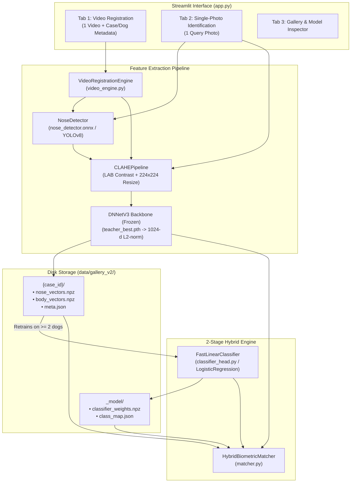
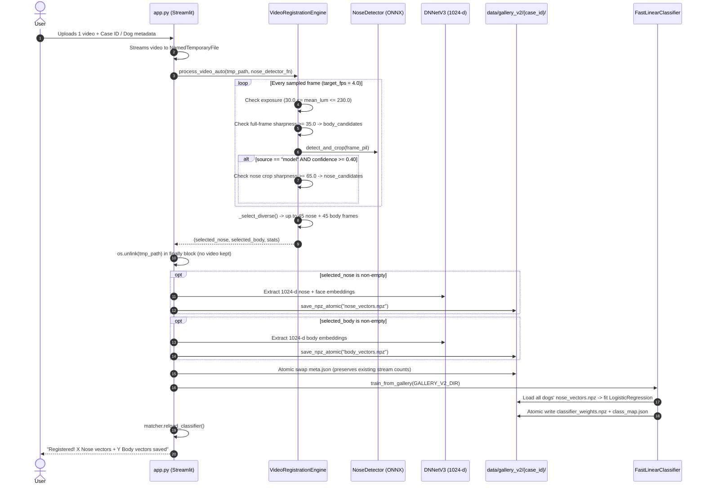
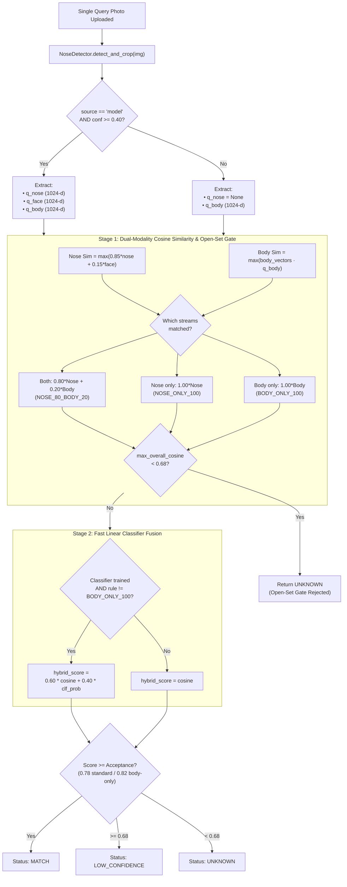

# `vidog_train_model` — Architecture & Complete Workflow Guide

This document explains the complete architecture, data storage format, 2-stage hybrid matching logic, model training mechanics, and inference settings for **`vidog_train_model`**.

---

## 1. High-Level Architecture

`vidog_train_model` is a **Single-Video Auto-Split + 2-Stage Hybrid Biometric System**.
Unlike `vidog_pure_cosine_similarity` (which accepts two separate videos and matches purely via cosine similarity), `vidog_train_model` accepts **one video**, automatically separates nose and body frames using YOLOv8, stores unified `.npz` vector matrices, and trains a fast per-gallery **Logistic Regression boundary head** on top of the frozen `DNNetV3` backbone.



---

## 2. The Two Models: Backbone vs. Classifier Head

| Property | Model 1: `DNNetV3` (`teacher_best.pth`) | Model 2: `FastLinearClassifier` (`classifier_weights.npz`) |
| :--- | :--- | :--- |
| **Role** | **Feature Extractor** (Pixels $\rightarrow$ 1024-d vector) | **Decision Boundary Head** (1024-d vector $\rightarrow$ Dog Probabilities) |
| **Architecture** | `TinyViT-21M` (576-d) + MagFace bottleneck head (1024-d) | `sklearn.linear_model.LogisticRegression` (`lbfgs`, `C=1.0`, `class_weight="balanced"`) |
| **Training Mode** | **Pre-trained offline** on 170 dog nose identities (`annotateddataset3k`, 80.43% Val Rank-1). **Frozen** during app usage. | **Trained live in < 1 second** whenever a new dog is registered (requires $\ge 2$ dogs with nose vectors). |
| **What It Learns** | General canine snout dermal ridges, pores, and facial geometry. | Hyperplanes separating *your specific registered gallery dogs* from each other. |
| **Persistence** | `checkpoints/teacher_best.pth` (loaded with `weights_only=True`) | `data/gallery_v2/_model/classifier_weights.npz` (`coef`, `intercept`) + `class_map.json` (no `pickle`). |

---

## 3. Workflow 1: Single-Video Registration & Auto-Retraining



### Registration Details
1. **No Raw Media Retained**: The uploaded video is written to a temporary file only during frame extraction and deleted immediately inside a `try ... finally:` block. No `.jpg` thumbnails or raw `.mp4` files are stored in the gallery.
2. **Path Safety**: `safe_dog_dir()` sanitizes `dog_name` (`[^a-zA-Z0-9_-]`) and verifies `os.path.realpath()` containment inside `GALLERY_V2_DIR`.
3. **Atomic Writes**: `.npz` and `.json` files are written to a `.tmp_*` file first and swapped via `os.replace()` to prevent partial or corrupted writes.

---

## 4. Disk Storage Format (`data/gallery_v2/`)

The storage format matches `vidog_pure_cosine_similarity` so galleries are portable across both engines:

```text
vidog_train_model/data/gallery_v2/
├── _model/
│   ├── classifier_weights.npz    # coef: (C, 1024) float32, intercept: (C,) float32
│   └── class_map.json            # Ordered list of dog/case IDs matching classifier rows
└── {case_id}/
    ├── nose_vectors.npz          # nose_vectors: (N, 1024), face_vectors: (N, 1024)
    ├── body_vectors.npz          # body_vectors: (M, 1024)
    └── meta.json                 # Registration metadata & stream counts
```

### Example `meta.json`
```json
{
  "case_id": "case_1042",
  "dog_name": "Sheru",
  "breed": "Indie",
  "gender": "Male",
  "age_years": 2.0,
  "color": "Fawn",
  "created_at": "2026-11-26 10:05:00",
  "updated_at": "2026-11-26 10:05:00",
  "nose_frames_enrolled": 38,
  "body_frames_enrolled": 45,
  "has_nose_stream": true,
  "has_body_stream": true,
  "video_duration_sec": 12.4
}
```

---

## 5. Workflow 2: 2-Stage Hybrid Identification



---

## 6. Main Inference & Quality Settings

| Parameter | Default Value | File | Description |
| :--- | :--- | :--- | :--- |
| `target_fps` | `4.0` | `video_engine.py` | Frames inspected per second of video. |
| `target_k_frames` | `45` | `video_engine.py` | Maximum diverse frames kept per stream (nose and body independently). |
| `min_sharpness` | `65.0` | `video_engine.py` | Minimum Laplacian variance required on a cropped nose patch. |
| `min_body_sharpness` | `35.0` | `video_engine.py` | Minimum Laplacian variance required on a full-body frame. |
| `min_luminance` / `max_luminance` | `30.0` / `230.0` | `video_engine.py` | Grayscale mean exposure bounds; rejects pitch-black or blown-out frames. |
| `min_nose_confidence` | `0.40` | `video_engine.py` / `app.py` | Minimum YOLOv8 confidence (`source == "model"`) to treat a crop as a real nose. |
| `nose_weight` / `body_weight` | `0.80` / `0.20` | `matcher.py` | Stage 1 modality weights when both nose and body vectors exist. |
| `cosine_hybrid_weight` / `classifier_hybrid_weight` | `0.60` / `0.40` | `matcher.py` | Stage 1 cosine score vs. Stage 2 `FastLinearClassifier` probability fusion weights. |
| `open_set_threshold` | `0.68` | `matcher.py` | Open-set cosine gate; rejects unfamiliar dogs before classifier ranking. |
| `match_acceptance_threshold` | `0.78` | `matcher.py` | Minimum hybrid score to return `MATCH` when nose biometrics are used. |
| `body_acceptance_threshold` | `0.82` | `matcher.py` | Stricter threshold for `BODY_ONLY_100` fallback matches to limit false positives. |

---

## 7. Running `vidog_train_model`

```bash
source .venv/bin/activate
cd vidog_train_model
streamlit run app.py
```
